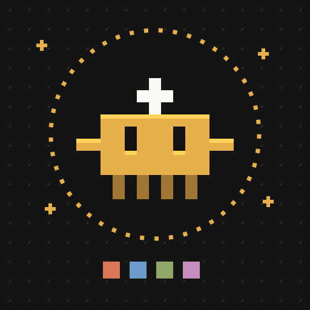

<p align="center">
  
</p>

<h1 align="center">Agent Crew</h1>

<p align="center"><b>See your Claude crew work, live.</b><br>
A Claude Code mod that draws the lead model, every helper agent it hands work to, and the tools and MCP servers they use, right beside the chat.</p>

<p align="center">
  
</p>

## Install

**Claude desktop app:** paste this into any Code chat and Claude installs it for you:

```
Install the Agent Crew mod for me: run `claude plugin install agent-crew --marketplace lurkar/agent-crew`, then tell me to start a new session.
```

**Claude Code in a terminal:** paste this at the prompt, answer `y`, then press Enter:

```
/plugin install agent-crew --marketplace lurkar/agent-crew
```

**From a shell** (PowerShell, Terminal, bash):

```
claude plugin install agent-crew --marketplace lurkar/agent-crew
```

Or, in the desktop app, click **+** next to the prompt box, then **Plugins**, **Add marketplace** with `lurkar/agent-crew`, then **Add plugin**.

It shows up in every session you start after that, in every project. No account, no key, nothing to set up.

## What you see

- **The lead**: the model running your conversation, and whether it is thinking, using a tool, or waiting for you.
- **Its helpers**: every agent the lead hands work to, with its model, its task, and what it is doing right now. Lines show who handed work to whom, including a helper that starts a helper of its own.
- **Tools and MCP servers**: each one lights up while it is in use. Built-in tools are grouped as terminal, files and web. Every MCP server you have connected gets its own node automatically, whatever it is: Blender, an image generator, mail, a database, your own server.
- **The details**: a list of each helper's task, time, tool calls and tokens, and a short activity log of handoffs and finished work.

Every model family has its own creature and color, so you can tell at a glance which model is doing which job:

<p align="center">
  
</p>

## Using it

The pane opens by itself. To hide or show it, press **Hide crew / Show crew** in the band above the prompt, or type `/crew`. If you hide it, it stays hidden in later sessions until you show it again.

## Where it works

- **Claude desktop app** and the **VS Code extension**: the full animated picture.
- **Terminal**: a compact text view of the same crew.
- **Mobile**: the picture, opened on request with the button.

## Privacy

Agent Crew only watches the session it runs in. It keeps the crew in that session's own state and remembers one setting: whether you hid the pane. It sends nothing anywhere and makes no network requests. It never changes, blocks or delays a tool call; it only observes.

## Development

```
claude plugin validate .
claude plugin test .
```

`hooks/draw.ts` holds everything that is drawn and the state changes behind it, as plain functions. `hooks/register.tsx` holds the hooks. `types/index.d.ts` is the state contract.

## License

[MIT](LICENSE)
